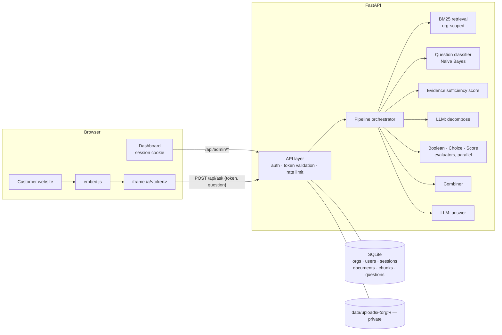

# AI Knowledge & Decision Assistant

A multi-tenant SaaS MVP. Each organization uploads its PDFs and gets a secure assistant link. It can embed the assistant on any website. Visitors ask questions and get grounded answers with **document + page references**.

The core design idea is to **separate the jobs of an LLM from the jobs of specialized decision models**:

| Responsibility | Handled by |
|---|---|
| Understanding language, extracting the visitor's facts, turning policy text into typed rules | **LLM** (pluggable: Groq / Gemini free tiers, Ollama, Claude) |
| Question-type classification, evidence sufficiency, Boolean/Choice/Score decisions | **System 1 models** (fast, deterministic, no LLM) |
| Routing, parallel execution, combining results, failure handling, tenant isolation | **Application logic** |
| Writing the final natural-language answer from the computed result | **LLM** |

The LLM never decides whether someone is eligible. It translates the question and the policy into structured specs, and the System 1 evaluators compute the outcome.

For a plain-English, step-by-step explanation of how a question is answered (with a worked example, the files involved and the API calls), see **[ARCHITECTURE.md](ARCHITECTURE.md)**.

---

## 1. Setup

### Prerequisites
- Python 3.11+ (tested on 3.14)
- A free LLM API key, no credit card needed. Either:
  - **Groq**: https://console.groq.com/keys (default model `llama-3.3-70b-versatile`, very fast)
  - **Google Gemini**: https://aistudio.google.com/apikey (default model `gemini-flash-latest`, an alias for the current Flash model; Google retired `gemini-2.5-flash` for new keys)

  Paid Anthropic keys and local Ollama models also work; see *LLM providers* below.

### Install and run
```bash
python -m venv .venv
# Windows: .venv\Scripts\activate      macOS/Linux: source .venv/bin/activate
pip install -r requirements.txt

cp .env.example .env            # Windows: copy .env.example .env  -> then set GROQ_API_KEY or GEMINI_API_KEY

python sample_data/generate_pdfs.py   # builds the sample PDFs (already committed, safe to re-run)
python -m scripts.seed_demo           # creates 2 demo orgs, uploads their PDFs, prints logins + assistant URLs
uvicorn app.main:app --reload --port 8000
```
Open http://localhost:8000. You can log in with a demo account or register a new organization.

| Demo org | Login | Password |
|---|---|---|
| Northbridge University | `admin@northbridge.edu` | `demo-pass-123` |
| Acme Logistics | `hr@acmelogistics.example` | `demo-pass-123` |

### Environment variables (`.env`)
| Variable | Default | Purpose |
|---|---|---|
| `LLM_PROVIDER` | `auto` | `auto` / `groq` / `gemini` / `ollama` / `anthropic` / `openai-compatible` |
| `GROQ_API_KEY` / `GEMINI_API_KEY` / `ANTHROPIC_API_KEY` | none | Set one. With `auto`, the first key found is used (Anthropic → Groq → Gemini) |
| `LLM_MODEL` | provider default | Overrides the model name |
| `LLM_FALLBACK_MODELS` | `default` | Models tried when the main one is overloaded (503/429), after two retries with backoff. `default` = `gemini-flash-lite-latest` / `llama-3.1-8b-instant`; empty = none |
| `LLM_BASE_URL` / `LLM_API_KEY` | none | For `openai-compatible` endpoints (e.g. OpenRouter) or a non-default Ollama host |
| `PUBLIC_BASE_URL` | `http://localhost:8000` | Used to build assistant URLs and embed code |
| `DATA_DIR` | `./data` | SQLite database and uploaded PDFs |
| `COOKIE_SECURE` | `false` | Set `true` behind HTTPS |

Without any key the app still runs. Retrieval, classification and the evidence gate work, and the assistant falls back to showing the most relevant cited passages.

### LLM providers
| Provider | Cost | Setup |
|---|---|---|
| Groq | Free tier | `GROQ_API_KEY=...` |
| Google Gemini | Free tier | `GEMINI_API_KEY=...` |
| Ollama (local) | Free, runs offline | Install Ollama, run `ollama pull qwen2.5:3b`, set `LLM_PROVIDER=ollama`. A 7B+ model is recommended for good decomposition quality, and it is slow on laptops without a GPU. |
| Anthropic Claude | Paid | `ANTHROPIC_API_KEY=...` (uses native structured outputs) |
| Any OpenAI-compatible API | Varies | `LLM_PROVIDER=openai-compatible`, `LLM_BASE_URL`, `LLM_API_KEY`, `LLM_MODEL` |

Free tiers have per-minute rate limits. If one is hit, the visitor sees a clear "rate limited" message and the relevant excerpts.

### Embedding on another website
```bash
python -m http.server 5500 -d demo
# open http://localhost:5500/external_site.html?token=<assistant token>
```
The demo page is served from a different origin (port 5500) to show that cross-site embedding works. You can also paste the embed code from the dashboard into `demo/external_site.html`.

### Tests and evaluation
```bash
python -m pytest -q                    # 61 tests: isolation, limits/errors, System 1 models, pipeline, LLM providers (all mocked, no key needed)
python -m scripts.run_test_questions   # runs the 16 sample questions through the real pipeline (needs an LLM key)
```

---

## 2. Architecture



### Components
| Component | File | Notes |
|---|---|---|
| API layer and pages | `app/main.py` | Admin APIs (session), visitor APIs (assistant token), security headers, rate limiting |
| Auth and tokens | `app/auth.py` | PBKDF2 passwords, hashed session tokens, assistant token issue/validate/rotate |
| Ingestion | `app/documents.py` | Limit validation, text extraction, header/footer removal, page-aware chunking |
| Retrieval | `app/retrieval.py` | Per-org BM25 index, cached and auto-invalidated |
| System 1 models | `app/system1/` | `classifier.py`, `evidence.py`, `decisions.py` |
| LLM stages | `app/llm.py` | Provider-pluggable. Groq/Gemini/Ollama via the OpenAI-compatible API (JSON mode + schema + Pydantic validation, one corrective retry), or Claude via native structured outputs |
| Typed contract | `app/schemas.py` | Facts, Conditions, DecisionSpecs, Decomposition, GeneratedAnswer |
| Combiner | `app/combiner.py` | Three-valued combination, missing facts, failure flags |
| Orchestrator | `app/pipeline.py` | Stage ordering, parallelism, routing, fallbacks, trace, usage logging |
| Frontend | `static/` | Vanilla HTML/JS (no build step): auth, dashboard, chat, `embed.js` |

### Request flow for `POST /api/ask`
```
Visitor question
 1. [API]        validate assistant token server-side -> org_id; validate question; rate-limit
    [App logic]  greetings / thanks get a friendly reply (no retrieval, no LLM)
 2. [System 1]   BM25 retrieval (org-scoped)  ||  question-type classifier            (in parallel)
 3. [System 1]   evidence sufficiency score -> "none": answer "not in knowledge base" (0 LLM calls)
 4. [App logic]  route: decision/comparison question (or classifier unsure) -> decompose, else answer directly
 5. [LLM]        decompose: question + passages -> facts + independent typed DecisionSpecs
 6. [System 1]   evaluate every DecisionSpec (Boolean / Choice / Score)                (in parallel)
 7. [App logic]  combine with three-valued logic; collect missing facts; flag failures
 8. [LLM]        write the answer from passages + the authoritative decision results, citing [S#]
 9. [App logic]  map citations -> document + page references; log usage; save the turn to the conversation
```
Every response includes a `trace`, shown in the chat under "How this answer was produced". It lists each stage, which component ran it (LLM / System 1 / App logic) and its latency. It also shows the classifier probabilities, the extracted facts, each decision with its per-condition results, and the combined outcome. The trace documents architecture and data flow, not model chain-of-thought.

---

## 3. Knowledge base

**Upload validation** (`app/documents.py`). Each check returns a specific, user-readable error:
- `.pdf` extension and `%PDF-` magic bytes (415)
- ≤ 10 MB. The server reads at most 10 MB + 1 byte, so it never buffers oversized files (413)
- ≤ 20 pages (413) and ≤ 10 documents per org (409). Replacing a document is allowed at the limit.
- Corrupt or password-protected files (422). Blank PDFs with no text and no images are rejected (422).
- **Scanned / image-only pages are read with OCR** (see below). If OCR fails, the upload is rejected with the reason (422).

**Processing**
1. Extract text per page with `pypdf`.
   - **OCR for scanned pages:** a page with under 20 characters of text that contains an image is rendered to a grayscale PNG with `pypdfium2` (≤ 2000 px) and transcribed by the configured vision-capable LLM (Gemini / Claude), 3 pages in parallel. Rendering is serialized because pdfium isn't thread-safe. The dashboard marks such documents with an **OCR** badge. Truly blank pages are never sent. Note that OCR sends page images to the LLM provider.
2. Remove running headers and footers: lines that repeat on more than half the pages, with digits ignored so "Page 2 of 5" matches.
3. Chunk each page into ~900-character sentence-packed chunks with a one-sentence overlap. **Chunks never cross a page boundary**, so every passage maps to exactly one document and page.
4. Store the chunks in SQLite with `org_id`, `document_id` and `page`.

**Retrieval.** Okapi BM25 over chunk text plus the file name, with a light stemmer and stopword removal. Query words also match close variants that occur in the org's documents, at a discount: abbreviation prefixes and suffixes such as `gpa` ↔ `cgpa` (0.8), and one-letter typos for words of 5+ letters (0.7). The evidence score uses the same matching. The index is built from `WHERE org_id = ?` rows only and cached per org. The cache key is `(COUNT, MAX(id))` of the org's chunks, so uploads and deletes invalidate it automatically. Top 6 passages are used (8 for comparison questions).

**References.** The LLM cites passage ids such as `[S2]`. The server keeps only ids it actually supplied and maps them to `{document, page, snippet}`. The UI shows numbered citation chips and a *Sources* list such as `Scholarship_Rules.pdf — Page 5`.

---

## 4. AI architecture

### LLM stages (structured, schema-validated output)
1. **Decompose**. Input: the question, the retrieved passages and the question type. Output: a validated `Decomposition`:
   - `facts`: normalized visitor facts, e.g. `gpa=3.72`, `year_of_study=2`, `sports_scholarship_amount=4000`
   - `decisions`: independent `DecisionSpec`s (boolean / choice / score) whose conditions cite the passage that states the rule (`source: "S2"`)
   - `combine`: `all` / `any` / `none`

   The prompt forbids inventing thresholds and forbids guessing facts. A missing fact is left missing so the rules engine can report it.

   Every LLM response is validated against the Pydantic schema in `app/schemas.py`. If it doesn't validate, the model gets one retry with the validation error. If that also fails, the stage fails cleanly (decomposition → `needs_review`; answer → cited-excerpt fallback). Because the verdict comes from the System 1 evaluators, a small free model is enough: it only has to translate text into rules, not reason about eligibility.
2. **Generate**. Input: the question, the passages and the decision results. The results are marked **authoritative**: the model explains them and does not re-decide them. Output: `GeneratedAnswer {answer, sources_used, grounded}`.

### System 1 models
| Model | Type | What it does |
|---|---|---|
| Question classifier | **Classification** | Multinomial Naive Bayes (unigrams + bigrams, `<num>` token) trained on a domain-neutral seed set. Returns a probability distribution over factual / policy / procedural / decision / comparison. Takes microseconds. |
| Evidence sufficiency | **Score** | IDF-weighted coverage of the question's topical terms by the top passages. Terms absent from the org's corpus get maximal IDF, so off-topic questions score near 0. |
| Boolean evaluator | **Boolean** | Evaluates typed conditions (`>= > <= < == != in not_in is_true is_false`) with **three-valued logic** (TRUE / FALSE / UNKNOWN when a fact is missing). |
| Choice evaluator | **Choice** | Picks the first option, in policy priority order, whose conditions all hold, e.g. Gold / Silver / Bronze tier. Returns UNKNOWN if a higher-priority option can't be settled yet. |
| Score evaluator | **Score** | Weighted support score in [0, 1] with a strong / moderate / weak band, and the reachable range if facts are missing. |

Decisions are evaluated **in parallel** (`asyncio.gather`). Each one is isolated: a malformed spec becomes an `error` result without affecting the others.

### Combination (application logic)
- Boolean results are combined with Kleene AND/OR. FALSE dominates UNKNOWN, so a visitor who clearly fails one rule gets **no** even if other facts are missing.
- The overall outcome is one of `yes`, `no`, `insufficient_information` (with the list of missing facts to ask for), `informational`, or `error`.
- A failed required decision gives `error`. The answer LLM is then told not to give a verdict, and the question is logged as *needs review*.

### Worked example (multiple decisions)
> *"I'm a second-year full-time student with a 3.72 GPA and no misconduct record. I already have a sports scholarship worth $4,000 a year. Am I eligible for the Merit Scholarship, and which tier would I get?"*

| Step | Component | Output |
|---|---|---|
| Classify | System 1 | `decision` (≈100%), so route to decomposition |
| Retrieve | System 1 | Scholarship_Rules p2 (eligibility), p5 (stacking), p3 (tiers) |
| Decompose | LLM | facts: full_time=true, year=2, gpa=3.72, misconduct=false, sports_amount=4000. Five boolean decisions plus one choice decision. |
| Evaluate (parallel) | System 1 | D1 full-time ✅ · D2 year ∈ {2,3,4} ✅ · D3 GPA ≥ 3.5 ✅ · D4 no misconduct ✅ · D5 sports award < $5,000 ✅ · D6 tier → **Silver ($6,000)** |
| Combine | App logic | `all` → **yes** |
| Answer | LLM | "Yes, you're eligible… Silver tier, $6,000 per year [p2][p3][p5]" |

With `$6,000` instead of `$4,000`, D5 becomes FALSE and the overall result becomes **no**. The LLM output didn't change the verdict; the rule did.

### Conversation memory
Visitors can continue a conversation. The chat remembers it across page reloads, and **New chat** starts over.
- **Transcript:** each conversation (`conversations` + `messages` tables) keeps the recent turns. The last 6 messages are given to both LLM stages so follow-ups like "what about the Gold tier?" or "how do I apply for it?" are understood.
- **Fact memory:** facts the visitor stated (`gpa=3.9`, `year_of_study=3`, …) are stored in the conversation and merged into every later decision, with new values overriding old ones. The System 1 evaluators then use them deterministically.
- **Waiting decisions:** when the outcome is `insufficient_information`, the conversation records which facts are missing. The visitor's next message (even just "3.9") is routed back into the decision.
- **Follow-up search:** a message that can't stand alone (like "3.9") is searched together with the recent questions. A complete new question is searched on its own, so a topic change isn't polluted by old context.
- **Isolation:** a conversation belongs to one organization. An id that is unknown, older than 7 days or from another organization is ignored, and a new conversation is started.

Live example (Gemini):
1. "Am I eligible…? I'm a third-year full-time student" → GPA unknown, so the assistant asks for it.
2. "My GPA is 3.9" → **Yes** (year and full-time come from memory).
3. "What if it were 3.6?" → still eligible, **Bronze**.
4. "How do I apply for it?" → the application steps.

### Why this split
- **Correctness and auditability.** Threshold comparisons and AND/OR logic are exactly where LLMs are unreliable, and they are trivial for code. Each verdict can be traced to a condition and a page.
- **Grounding.** There are two layers. The System 1 evidence gate refuses clearly off-topic questions before any LLM call. The answer LLM independently reports `grounded=false` when the passages don't answer the question. Both give "not in the knowledge base", never an invented answer.
- **Cost and latency.** Classification routes simple factual and procedural questions straight to a single LLM call. Off-topic questions cost zero LLM calls. Only decision-shaped questions pay for decomposition.
- **Missing information is handled properly.** Three-valued logic turns "you didn't tell me your GPA" into a follow-up question instead of a guess.

---

## 5. Security and tenant isolation

| Control | Implementation |
|---|---|
| Admin authentication | Email + password (PBKDF2-SHA256, 200k iterations). Session is a random 256-bit cookie (`HttpOnly`, `SameSite=Strict`, `Secure` when configured), stored only as a SHA-256 hash, with a 7-day expiry. |
| Admin authorization | Every `/api/admin/*` route depends on `require_admin`, which reads **only** the session cookie and derives `org_id` from the server-side session. Clients never send an org id. |
| Assistant token | `ast_` + 192 random bits, unrelated to passwords, users or documents. Validated server-side on every request. Can be regenerated from the dashboard, which invalidates the old URL and embed code immediately. |
| Token ≠ admin access | Assistant tokens are ignored by admin auth. Tests send them as a Bearer header, query parameter and forged session cookie, and all return 401. |
| Data isolation | Every tenant table has `org_id`. Every document, chunk and usage query filters by the org from the session or token. The BM25 index is built per org. Cross-org delete or replace returns 404. |
| Private documents | PDFs are stored under `data/uploads/<org_id>/<uuid>.pdf`, outside the static directory. No route serves them. Visitors only ever receive short snippets of cited chunks. |
| Embedding | `/a/*` and `embed.js` allow framing (`frame-ancestors *`, `no-referrer`). The dashboard and admin APIs send `X-Frame-Options: DENY` and `frame-ancestors 'none'`. There is no CORS, so admin APIs can't be called cross-origin. |
| Abuse | Per-token and per-IP rate limit on `/api/ask` (30/min). Questions are limited to 1,000 characters. |

**Isolation is tested explicitly** in `tests/test_isolation.py`:
- Retrieval for org B never returns org A's chunks.
- The LLM only ever sees the asking org's documents.
- A Northbridge-only question asked to Acme's assistant gets "not in knowledge base" with zero LLM calls.
- Assistant tokens are rejected by admin APIs.
- Cross-org delete and replace return 404.
- PDFs are unreachable over HTTP.
- Rotated and invalid tokens return 404.
- The dashboard can't be framed.

---

## 6. API

| Method | Path | Auth | Purpose |
|---|---|---|---|
| POST | `/api/auth/register` | none | `{org_name, email, password}`: create org + admin, start session |
| POST | `/api/auth/login` | none | `{email, password}` |
| POST | `/api/auth/logout` | session | End session |
| GET | `/api/admin/me` | session | Org name, email, limits |
| GET | `/api/admin/documents` | session | List documents (pages, size, chunks, date) |
| POST | `/api/admin/documents` | session | Upload a PDF (multipart `file`) |
| POST | `/api/admin/documents/{id}/replace` | session | Replace a document in place |
| DELETE | `/api/admin/documents/{id}` | session | Delete document, its chunks and its file |
| GET | `/api/admin/assistant` | session | Assistant URL, iframe embed, script embed |
| POST | `/api/admin/assistant/regenerate` | session | Rotate the assistant token |
| GET | `/api/admin/usage` | session | Counts (asked / answered / not in KB / review / errors) and recent questions |
| GET | `/api/assistant/{token}` | token | Public info (org name only) |
| GET | `/api/assistant/{token}/conversations/{id}` | token | Transcript of a conversation, for restoring the chat (404 if unknown, expired or another org's) |
| POST | `/api/ask` | token | `{token, question, conversation_id?}` → `{status, answer, references[], error, latency_ms, conversation_id, trace}` |
| GET | `/a/{token}` · `/embed.js` | token | Visitor chat page · embed script |

`status` is one of `answered`, `unable_to_answer`, `needs_review` or `error`.

**Error handling.** Every error returns `{"detail": "<human-readable message>"}`:
- Invalid PDF, over-limit files and processing failures during upload.
- Invalid or revoked token (404) and empty or too-long questions (400).
- No relevant knowledge (`unable_to_answer`).
- LLM or API failure: `error`, returned with the top cited excerpts as a fallback.
- Decomposition or decision-model failure: `needs_review`, with the answer still generated and caveated.
- Rate limiting (429) and unexpected failures (500 with a generic message; details are logged server-side).

---

## 7. Test data

- `sample_data/northbridge_university/`: Scholarship_Rules (6 pp), Academic_Policies (3 pp), Student_Services_Guide (3 pp)
- `sample_data/acme_logistics/`: Leave_Policy, Remote_Work_Policy, Expense_Reimbursement_Policy (3 pp each)
- `sample_data/scanned/Parking_Notice_scanned.pdf`: an image-only page, to demo OCR
- `sample_data/invalid/`: a non-PDF, a 25-page PDF and a blank PDF, for the error demos
- `sample_data/test_questions.json`: 16 questions with expected outcomes and sources. They cover direct information, policy, procedural, multi-condition decisions (NB-4, NB-5, NB-6, NB-7, AC-2), multiple structured decisions (NB-4: 5 boolean + 1 choice), comparison (NB-8, AC-5), not in KB (NB-9, AC-6) and cross-tenant isolation (ISO-1).

---

### Live evaluation (Gemini `gemini-flash-latest`)
`python -m scripts.run_test_questions --delay 6` runs all 16 questions through the real pipeline:

| Result | Details |
|---|---|
| **16 / 16 correct** | Every verdict, tier and fact matches `expected`, with the correct page references |
| Not in KB / cross-tenant (NB-9, AC-6, ISO-1) | Refused by the evidence gate with **0 LLM calls** (~15 ms) |
| Direct / policy / procedural | 1 LLM call each |
| Decision / comparison | 2 LLM calls; decisions evaluated in parallel in ~1–10 ms |

The first run scored 15/16. For AC-2 (a dispatcher asking about remote work), Gemini encoded "role must not be on-site essential" as `role != "warehouse operations, fleet maintenance and dispatch"` (a single string compared to a whole list), so the check wrongly passed. Two fixes followed:
1. The Boolean evaluator now treats `==`/`!=` against a list as a membership test.
2. App logic splits bundled requirements into one independent decision each (`split_compound_decisions`).

Both have regression tests. This is the architecture paying off: the fault was diagnosable from the trace and fixable deterministically, without prompt guesswork.

## 8. Known limitations and production improvements

| Limitation | Production improvement |
|---|---|
| Lexical BM25; abbreviations and typos are handled by variant matching, but true synonyms (e.g. "salary" vs "compensation") can still be missed | Hybrid retrieval: add embeddings (e.g. pgvector) and fuse with BM25; add a reranker |
| The evidence-gate threshold was tuned on the sample corpus | Calibrate on a labelled question set per tenant, and log gate decisions for review |
| The Naive Bayes seed set is small | Retrain on logged, labelled questions; add per-tenant intent labels |
| Rules are extracted from text on every question | Pre-compile policy rules at ingestion into a versioned rules store that admins can review and approve, so decisions run with zero LLM involvement |
| OCR depends on a vision-capable LLM (Groq's default text model can't do it) and adds ~5–15 s per scanned page; tables are flattened | Dedicated OCR (e.g. Textract / Document AI) run as a background job; layout-aware table parsing |
| Synchronous ingestion | Background job queue with a processing status for larger files |
| SQLite, in-memory rate limit and index cache | Postgres with row-level security per tenant, Redis, object storage for PDFs (S3 + KMS) |
| Simple auth | Email verification, password reset, MFA/SSO, multiple users and roles per org, CSRF tokens, audit log |
| Fact memory trusts the LLM to reuse fact names (`gpa` vs `cumulative_gpa`), and a hypothetical ("what if my GPA were 3.6?") updates the remembered value | Canonical fact vocabulary per tenant; mark hypothetical facts as turn-only |
| No human-review queue | Dashboard inbox for `needs_review` / `unable_to_answer` questions, with feedback on answers |
| Assistant token embedded in public pages | Optional per-token allowed-origin lists and signed short-lived session tokens for embeds |
